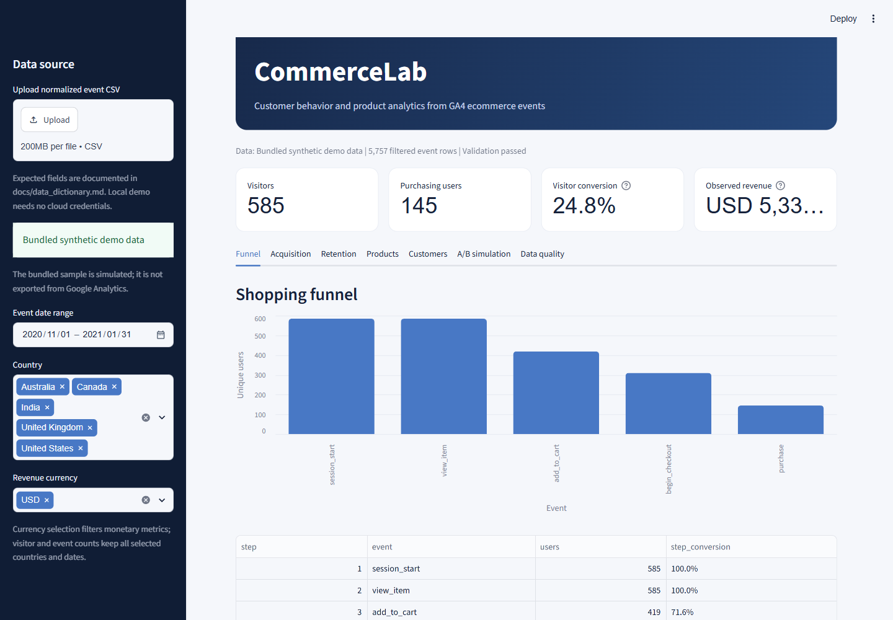

# CommerceLab

**An end-to-end customer behavior and product analytics portfolio project built around GA4 ecommerce events.** Explore shopping funnels, acquisition, retention cohorts, product performance, customer segments, and statistical summaries in a local interactive dashboard.

> **Data honesty:** the bundled CSV is deterministic simulated data shaped like normalized GA4 events. It is not Google's GA4 public sample. The optional BigQuery ingestion targets Google's public dataset `bigquery-public-data.ga4_obfuscated_sample_ecommerce`; running a BigQuery query still requires Google credentials and a billing project. The A/B tab is a seeded synthetic experiment for teaching analysis only.

## Dashboard preview

The screenshot below is from the running app using the bundled simulated dataset. It is a UI preview, not a report of real Google Analytics results.



[Mobile layout capture](screenshots/dashboard-mobile.png)

## What you can explore

- Event ingestion from the normalized CSV contract, with optional BigQuery public sample loading.
- Data validation: schema, dates, numeric values, duplicates, null user IDs, and event counts.
- Descriptive event funnel and visitor conversion with a Wilson 95% interval.
- Acquisition channel sessions, purchases, revenue, and conversion.
- Monthly retention cohorts and product event/revenue summaries.
- Rule-based RFM segmentation plus a bootstrap interval for mean customer spend.
- A separately labeled synthetic randomized A/B test module with a two-sided proportion z-test.
- BigQuery SQL examples (money queries require one `@currency` parameter), tests, CI, architecture and publishing guidance.

## Run locally (no cloud account required)

Requires Python 3.10 or newer. From the `CommerceLab` directory:

```powershell
py -m venv .venv
.\.venv\Scripts\python.exe -m pip install --upgrade pip
.\.venv\Scripts\python.exe -m pip install -e ".[dev]"
.\.venv\Scripts\python.exe -m streamlit run src/commercelab/dashboard.py
```

Open the local URL Streamlit prints, usually `http://localhost:8501`. The app loads `data/sample/events.csv` automatically and runs without credentials. Or upload another CSV using the documented normalized schema.

If you installed CommerceLab before updating its dependencies, upgrade Altair inside the virtual environment with `.\.venv\Scripts\python.exe -m pip install --upgrade "altair>=6,<7"`. Python 3.14 requires Altair 6 or newer; the project pins the compatible Altair 6 line. Then run the app command above again.

To verify locally:

```powershell
.\.venv\Scripts\python.exe -m pytest -q
.\.venv\Scripts\ruff.exe check src tests scripts
.\.venv\Scripts\python.exe scripts/validate_demo.py
```

## Reproduce the demo data

The CSV generator uses Node.js and a fixed seed; it requires no network access:

```powershell
node scripts/generate_demo_data.js
```

The generator overwrites only `data/sample/events.csv` and its provenance note. Current sample row counts and validation output are reported by `scripts/validate_demo.py` after Python dependencies are installed.

## Optional public BigQuery sample

The source is [Google's public GA4 ecommerce sample](https://support.google.com/analytics/answer/10937659), covering sample dates from 2020-11-01 through 2021-01-31. See [Google's GA4 BigQuery export documentation](https://support.google.com/analytics/answer/7029846) and the dataset reference. Query jobs need a Google Cloud project with billing enabled, even though the source data is public. Install the optional connector and authenticate using Application Default Credentials:

```powershell
.\.venv\Scripts\python.exe -m pip install -e ".[bigquery]"
gcloud auth application-default login
$env:GOOGLE_CLOUD_PROJECT = "your-billing-project-id"
```

Use `scripts/ingest_bigquery.py` to query and save normalized rows, or call `commercelab.bigquery.load_public_sample()` directly. The corresponding extraction query is in `sql/normalize_ga4_events.sql`. For example:

```powershell
.\.venv\Scripts\python.exe scripts/ingest_bigquery.py --start-date 20201101 --end-date 20210131 --output data/processed/public_ga4_events.csv
```

Review date bounds and query bytes before running; this is a real cloud query and can incur charges. Public table schema can evolve, so the query may need updates if Google changes it.

## Analytics definitions and limits

- **Funnel:** distinct users with each event over the selected range. Stage counts are not sequenced by session, so this is reach by event, not a path analysis.
- **Conversion:** distinct purchasers divided by users with a `session_start` or `first_visit` event in the filtered rows. It is a window-level descriptive ratio.
- **Acquisition:** local labels summarize the channel column. BigQuery's sample uses first-user `traffic_source` fields, not reliable session attribution; interpret channel comparisons accordingly.
- **Retention:** a customer is active in a month if they have a `session_start` or `purchase`; cohort is the first month visible in the selected data window. Partial months and selected date windows affect rates.
- **RFM:** rules operate only on purchases visible in the selected window, with an arbitrary 45-day at-risk cutoff. This is illustrative, not a validated customer value model.
- **Statistics:** Wilson interval and percentile bootstrap are descriptive. They do not remove selection bias, missing events, or tracking error. The revenue-currency filter applies to monetary metrics only; visitor/event counts remain across the selected dates and countries. Choose one currency for comparisons; no currency conversion is applied, and missing currency is labeled `Unknown`.
- **A/B module:** synthetic seeded assignment exists only for code demonstration. Never present it as observed experiment evidence. Causal interpretation requires logged randomized assignment and exposure, a pre-specified metric/design, and data quality checks.

See [docs/architecture.md](docs/architecture.md), [docs/data_dictionary.md](docs/data_dictionary.md), and [docs/github_checklist.md](docs/github_checklist.md).

## Repository map

```text
CommerceLab/
├── .github/workflows/ci.yml
├── data/sample/               # deterministic simulated event CSV
├── docs/                      # architecture, data dictionary, publishing checklist
├── screenshots/               # desktop and mobile captures from the running app
├── scripts/                   # sample generator and validation command
├── sql/                       # BigQuery extraction and analytics
├── src/commercelab/           # ingestion, validation, analysis, dashboard
├── tests/
├── pyproject.toml
└── README.md
```

## CI and publishing

GitHub Actions installs the package, runs Ruff and pytest, and checks the bundled demo validation. A green local run does not imply a GitHub Actions run. Follow the explicit publishing steps in `docs/github_checklist.md` before pushing.

## License

MIT. See [LICENSE](LICENSE).
