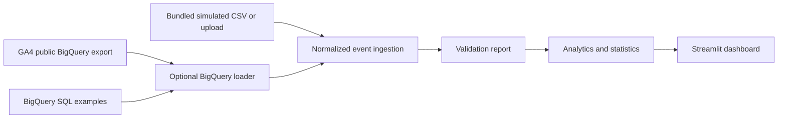

# Architecture

## Data flow

1. `bigquery.py` runs a parameterized date-range query only when explicitly called. It requires ADC credentials and a billing project. The local app never calls it.
2. `ingestion.py` loads the normalized flat CSV schema and converts dates, timestamps, quantities, and prices.
3. `validation.py` returns quality counts without silently dropping records. Invalid data blocks the dashboard.
4. `analytics.py` calculates funnel, conversion, channel, cohorts, product summaries, and RFM labels from the filtered event frame.
5. `statistics.py` provides Wilson conversion bounds and a seeded percentile bootstrap for average spend.
6. `abtest.py` independently generates synthetic randomized assignment data and a simple two-sided z-test demonstration.
7. `dashboard.py` ties these modules together in a tabbed, filterable Streamlit interface.

## Grain and attribution

A row in the normalized CSV is one event-item pair. Events without items have blank item fields; an item-bearing event can have multiple rows, so event counts and user counts can differ. The BigQuery query uses GA4's event `traffic_source` and maps source/medium to broad labels. For the 2020 sample, these fields do not represent modern session-level acquisition. The model keeps that limitation explicit.

The app computes event-stage distinct user counts independently. It does not attempt ordered event sequence reconstruction. User identity is the pseudonymous export identifier, not a known person.

## Extension points

- Add session sequencing using `session_id` and timestamp ordering.
- Store normalized rows in a warehouse and publish SQL views for larger extracts.
- Use GA4 session attribution fields when available, keeping source schema versions explicit.
- Add repeat purchase, basket, and item-view-to-purchase measures after defining event-level deduplication and unit semantics.
